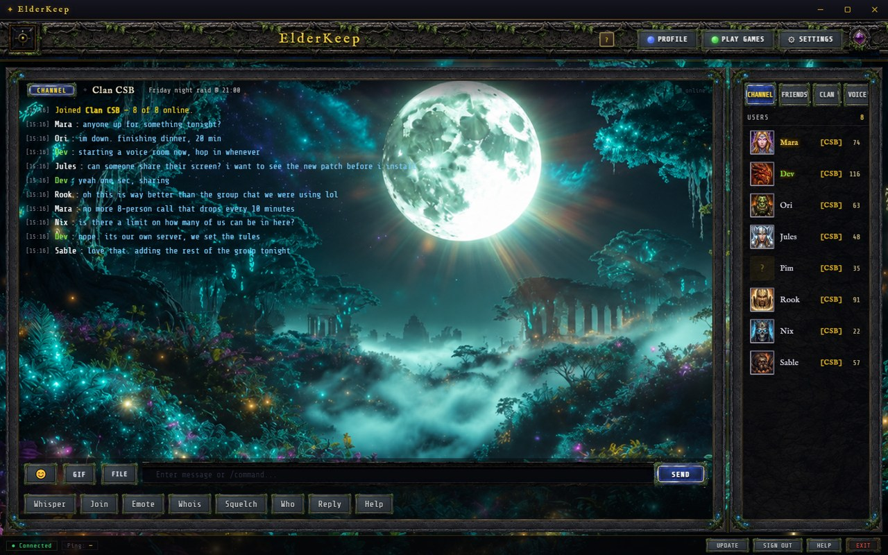
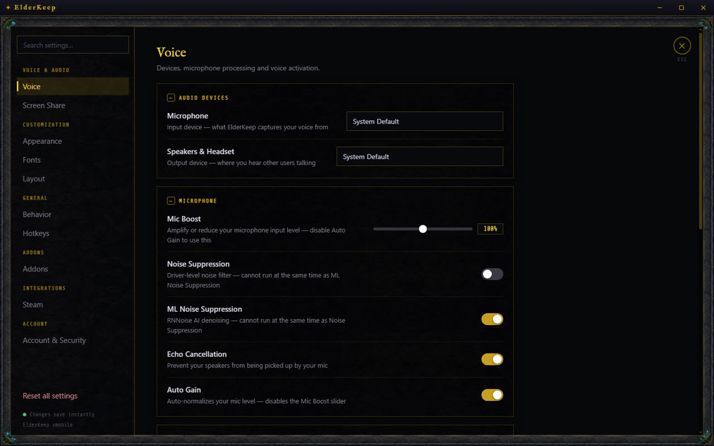
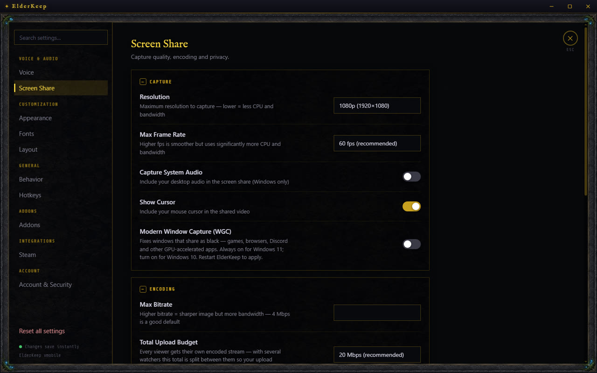
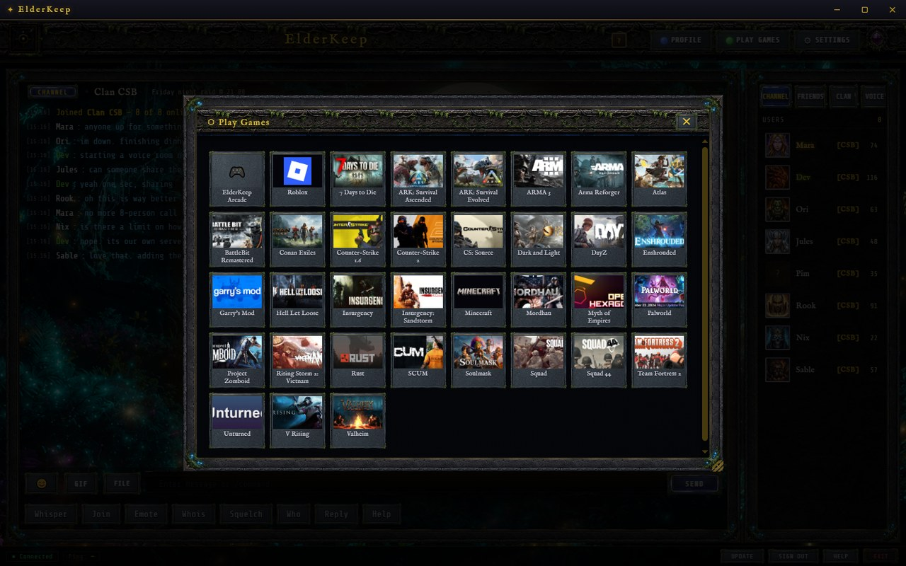
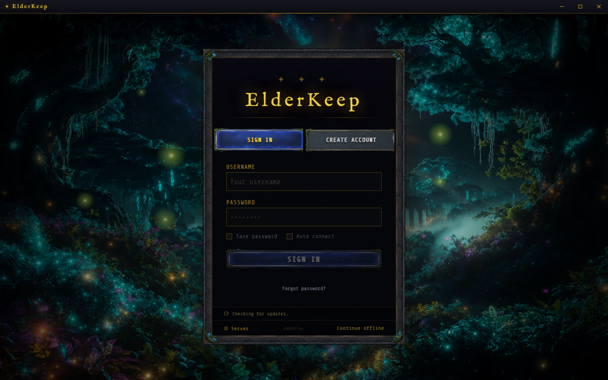

# ElderKeep

**A private space for your friend group.**

Voice rooms, screen sharing and chat for one group of people who actually know each other —
not a platform, not a social network, not a server full of strangers. Install it, make an
account, and you're in the same place as everyone else you know.

Free. No ads, no subscriptions, no tracking.

[**🌐 Website**](https://candymankillerz.github.io/elderkeep-client/) &nbsp;·&nbsp;
[**⬇ Download the latest release**](https://github.com/CandyManKillerZ/elderkeep-client/releases/latest)

`IN DEVELOPMENT` — stable enough to use every day, but still being built. Things change, and
features get added when the people using it ask for them.

---

## Screenshots

|                                                            |                                                              |
|:----------------------------------------------------------:|:------------------------------------------------------------:|
|                           |                  |
| **Chat** — channels, live member list, friends and clans    | **Voice** — devices, noise suppression, echo cancellation     |
|   |                 |
| **Screen share** — resolution, frame rate, system audio     | **Play Games** — find a server without leaving the app        |

Login screen

---

## Who it's for

A friend group, a guild, a few housemates, a small team — anyone who has outgrown a group chat
and doesn't want to hand their conversations to an ad company. Everyone lands in the same place
and can talk, share a screen, send files and mess about without any of it being a product.

## Download & Install

| Platform | File |
|----------|------|
| **Windows 10/11** | `ElderKeep-Setup-<version>.exe` (one-click installer) — or the portable `.zip` |
| **Linux (x64)** | `ElderKeep-<version>-x64.AppImage` or the `.deb` package |
| **Android** | [APK from the Android repo](https://github.com/CandyManKillerZ/elderkeep-android/releases/latest) |

Grab the latest build from the [**Releases**](https://github.com/CandyManKillerZ/elderkeep-client/releases/latest)
page. ElderKeep keeps itself current with a built-in **auto-updater**, so you only install once.

> **Windows SmartScreen, or "I ran the installer and nothing happened"?** The installer isn't
> code-signed yet, so Windows flags it with *Mark of the Web*. Right-click the downloaded `.exe`
> → **Properties** → tick **Unblock** → **OK**, then run it again.

## Getting started

1. Install and launch ElderKeep.
2. You connect to the ElderKeep server automatically — there's no address to type in.
3. Create an account and **save your one-time recovery codes**. They are the only way back in
   if you forget your password.
4. Join a channel, add some friends, and you're in.

## Features

### 💬 Chat
- Public channels, clan channels and clan sub-channels
- **End-to-end encrypted** whispers (ECDH P-256 + AES-256-GCM) — the server can't read them
- Replies, reactions, and `@mentions` with `@everyone` / `@here`
- Emoji and GIF pickers, inline images with a zoomable pop-out viewer
- Inline video — YouTube, Twitch, Vimeo and Streamable play in the chat window
- `/me` emotes and IRC-style moderation commands (kick, ban, op, whois, who, …)
- Daily chat logs kept locally on your own machine

### 🎙️ Voice
- Low-latency peer-to-peer voice rooms
- **Push-to-talk** or voice activation, with mute and deafen
- **RNNoise** background-noise suppression
- **Game-audio ducking** — your game drops in volume while someone talks
- Microphone test and full mic/speaker device selection
- Host-controlled calls — invite, add, remove, force-mute, end for everyone

### 🖥️ Screen sharing
- Share a whole screen or a single window, **with system audio**
- Adjustable resolution, frame rate and bitrate, with an auto-FPS guard
- A real viewer window — per-viewer volume, fullscreen, auto-reconnect
- See who's watching, and bandwidth budgeting across several viewers

### 📁 File transfer
- Send a file straight to someone, **peer to peer** — it never touches a server and is never
  written to disk anywhere but the recipient's machine
- Drag and drop onto a name, with a transfers panel, progress and cancel

### 👥 Friends & clans
- Friends list with favourites and live online/offline status
- See what your friends are playing on **Steam**, and jump into their game
- Clans with ranks, a message of the day, invites and shared history

### 🎮 Play Games
Find somewhere to play without leaving chat — browse and join servers across dozens of PC
games via the Steam Web API, plus a Roblox game and server browser with one-click join.
Favourites and recently-played are shared across all of it.

### 🕹️ Arcade
Built-in games with server-verified leaderboards, XP and badges — Arkanoid, Snake, Tetris,
Pac-Keep — plus **rated player-vs-player chess** with full move validation on the server.

### 🔒 Accounts & security
- One-time **recovery codes** and self-service password reset
- Optional saved password, encrypted with your OS credential vault (Windows DPAPI) — never
  stored in plain text
- Auto-connect on launch, once the update check confirms you're on the latest build

### 🎨 Polish
- Themes, accent colours, chat colours, fonts and layout options
- Animated backgrounds, profile icons, XP and level badges
- Floating chat-bubble overlay, system tray, and nine rebindable global hotkeys
- Patch notes in the app, so you can see what changed

## Platforms

Windows 10/11, Linux (x64) and Android.

## A note on servers

ElderKeep runs on one server, and everyone using this client is on it. **Self-hosting is not
currently available** — the server software isn't public. If that's something you want, say so
in an issue; what gets built next is driven by what people ask for.

## License

ElderKeep is **proprietary software** — © 2026 Mark van der Sluis. All rights reserved.
See [LICENSE](https://github.com/CandyManKillerZ/elderkeep-client/blob/main/LICENSE) for details.
Third-party open-source components remain under their own respective licenses.

For licensing inquiries, contact **noreply@elderkeep.app**.
